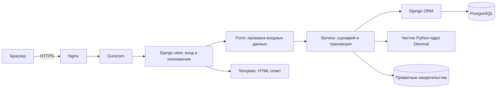

# Архитектура

> Актуализация 26.11.2026: модульный монолит сохранён. `Assessment` связан с несколькими контурами через `AssessmentContour`, с системами и расчётными областями уровней; создание и запуск выполняет администратор; `AuditEvent` снова используется для значимых действий. Старые одноконтурные описания ниже архивны.

Уточнение 10.11.2026: прикладной журнал действий отключён по явному решению пользователя; версии ответов и решений сохраняются. Прежние требования AuditEvent-журналирования ниже отменены этим решением. Карточка вручную / из учебного шаблона и матрица с вкладками реализованы; объём и ограничения — [INTERFACE_PROPOSAL.md](INTERFACE_PROPOSAL.md).

Актуальная реализация от 10.11.2026 описана в [IMPLEMENTATION_STATUS.md](IMPLEMENTATION_STATUS.md). Ниже сохранены проектные решения и история согласования; сведения «ещё не реализовано» относятся к прежнему состоянию.

Проект модульного монолита: Python 3.12, Django 5.2 LTS, Django Templates, ORM, PostgreSQL 16, Gunicorn, Nginx, Docker Compose. Конкретные patch-версии будут проверены и закреплены при создании каркаса.

Приложения: accounts — пользователи и роли; organization — единственный профиль и контуры; standards — версии каталога; assessments — область, ответы и согласование; evidence — закрытые файлы; calculations — расчёт и протокол; reports — снимки и экспорт; auditlog — события и авторы.

View проверяет сессию и права, form проверяет данные, service выполняет бизнес-правила и транзакцию, ORM сохраняет данные, template строит HTML. Расчётное ядро не вызывает сеть и не зависит от HTTP.

Только Nginx имеет внешний вход. App и db доступны внутри Compose, порт PostgreSQL на хост не публикуется. Файлы не раздаются публичным location Nginx. Скачивание проходит авторизацию Django. HTTP localhost допустим только как явно отмеченная разработка.

Основные угрозы: IDOR — объектные проверки; CSRF — штатная защита Django; опасные загрузки — лимиты, проверка типа, безопасные имена и attachment; подмена истории — версии и фиксация; гонки утверждения — транзакции и повторная проверка состояния. Секреты вне Git, журнал без паролей и содержимого файлов.

Область обследования: один контур и снимок одного уровня. Профиль организации единственный, обследований много во времени. Доступ назначает администратор; у обследования один сотрудник и один проверяющий — разные пользователи. После утверждения данные фиксируются; после закрытия исправления требуют нового обследования. Формулы объединения контуров/уровней в текущем рабочем сценарии не применяются.

На 09.11.2026 это проект архитектуры, не развёрнутая система. Статус и ограничения: [итоговый аудит этапа 0](STAGE_0_REVIEW.md). Факт использования Docker не является доказательством HTTPS, приватности файлов или восстановления — эти свойства проверяются после реализации.

09.11.2026, этап 1: каркас config/core реализован; compose.yaml относится только к HTTP localhost. Образы/тома/сети описаны, но запуск Compose и применение миграций пока не проверены в среде агента. Django-настройки production — защитная заготовка, не готовое HTTPS-развёртывание; фактические проверки и ограничения приведены в STAGE_1.md.
