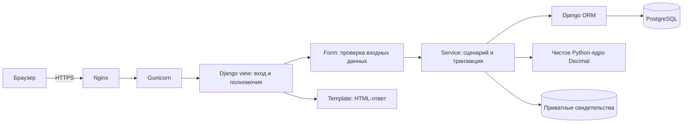

# Архитектура

Проект модульного монолита: Python 3.12, Django 5.2 LTS, Django Templates, ORM, PostgreSQL 16, Gunicorn, Nginx, Docker Compose. Конкретные patch-версии будут проверены и закреплены при создании каркаса.

Приложения: accounts — пользователи и роли; organization — единственный профиль и контуры; standards — версии каталога; assessments — область, ответы и согласование; evidence — закрытые файлы; calculations — расчёт и протокол; reports — снимки и экспорт; auditlog — события и авторы.

View проверяет сессию и права, form проверяет данные, service выполняет бизнес-правила и транзакцию, ORM сохраняет данные, template строит HTML. Расчётное ядро не вызывает сеть и не зависит от HTTP.

Только Nginx имеет внешний вход. App и db доступны внутри Compose, порт PostgreSQL на хост не публикуется. Файлы не раздаются публичным location Nginx. Скачивание проходит авторизацию Django. HTTP localhost допустим только как явно отмеченная разработка.

Основные угрозы: IDOR — объектные проверки; CSRF — штатная защита Django; опасные загрузки — лимиты, проверка типа, безопасные имена и attachment; подмена истории — версии и фиксация; гонки утверждения — транзакции и повторная проверка состояния. Секреты вне Git, журнал без паролей и содержимого файлов.
