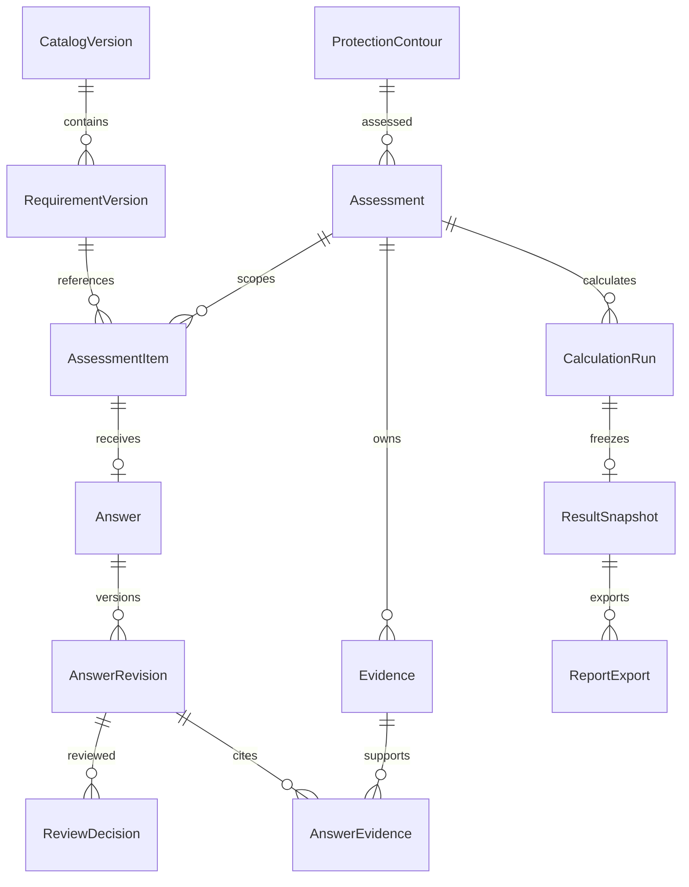

# Логическая модель — проект

> Актуализация 26.11.2026: действующая модель расширена сущностями `Employee`, `InformationSystem`, `AssessmentContour`, `CalculationArea`, `ScoreAdjustment` и `Recommendation`. Старый `Assessment.contour` сохранён как совместимый основной контур и переносится миграцией в новую связь. Одноконтурные ограничения ниже архивны.

Текущая связь: `Assessment → CalculationArea → AssessmentItem → AnswerRevision`. Область уникальна по обследованию и сохранённому уровню (1–3); строка анкеты — по обследованию, области, версии меры и процессу. Несколько контуров одного уровня не размножают строки. Миграция `0004_item_calculation_area` привязывает прежние одногрупповые строки, не изменяя ответы и JSON-снимки. Для прежних многогрупповых анкет с потерянным контекстом оставляет `area=NULL`: автоматическое копирование рассмотренных ответов запрещено, новый расчёт блокируется до создания корректного обследования.

Журнал значимых действий включён новым ТЗ. Решение 10.11.2026 об отключении журнала отменено; доменная история сохраняется.

Актуальная реализация от 10.11.2026 описана в [IMPLEMENTATION_STATUS.md](IMPLEMENTATION_STATUS.md). Ниже сохранены проектные решения и история согласования; сведения «ещё не реализовано» относятся к прежнему состоянию.

OrganizationProfile: единственный профиль; ProtectionContour: принадлежит профилю. Assessment: даты, автор, состояние, версия каталога, предыдущее обследование при повторной оценке. Assessment относится ровно к одному ProtectionContour (обязательная связь N:1). AssessmentScope фиксирует выбранный контур, его уровень и область, чтобы последующее изменение профиля не меняло историю.

CatalogVersion → RequirementVersion (1:N). Версия требования содержит код, раздел, процесс/подпроцесс, направление/этап при необходимости, применимость, редакцию, страницу/пункт, статус ручной проверки. Иерархию можно хранить узлами каталога, не создавая отдельную таблицу для каждого вида узла.

Assessment → AssessmentItem (1:N) → RequirementVersion (N:1). AssessmentItem фиксирует контекст оценки: область/уровень, процесс для мер управления, применимость. Одна мера управления может оцениваться отдельно для нескольких процессов; уникальности только по коду меры недостаточно.

AssessmentItem → Answer (1:1); Answer → AnswerRevision (1:N). AnswerRevision содержит описание сотрудника и связи со свидетельствами. ReviewDecision содержит оценку проверяющего (при наличии), мотивировку, конкретную ревизию, автора и время; новая ревизия требует нового решения. Отсутствующая оценка отличается от нуля. AnswerRevision и Evidence связаны многие ко многим через AnswerEvidence: одна версия ответа может подтверждаться несколькими документами, один документ — несколькими ответами в пределах одного обследования. AnswerEvidence содержит ссылку на раздел/страницу документа и пояснение подтверждаемого факта. Evidence принадлежит обследованию; контекст версии требования определяется через связанную ревизию ответа. Перекрёстное присоединение из другого обследования запрещено. Прикрепление документа само по себе не подтверждает соответствие; содержание рассматривает проверяющий.

Старые ревизии ответов, связи со свидетельствами и решения сохраняются для просмотра. Изменение ответа или его подтверждающих материалов создаёт новую ревизию, требующую нового решения проверяющего; прежнее решение остаётся связано со старой ревизией. Использованный файл не перезаписывается, новая редакция документа сохраняется отдельно.

Закрытое обследование доступно только для чтения уполномоченным пользователям. Повторная оценка создаёт новое Assessment со ссылкой на предыдущее; при неизменных требованиях используется та же CatalogVersion. Новый шаблон/каталог не требуется только из-за повторной оценки. Новое обследование требует собственных ответов и решений; прошлое утверждение не переносится автоматически. Закрывает обследование внутренний проверяющий; основные переходы приведены в PERMISSIONS.md. Ранее предложенная фиксация при утверждении сохраняется: закрытие не открывает возможность менять утверждённые данные.

ScopeExclusion хранит основание, область и решение проверяющего. CompensatingMeasure связана с заменяемой мерой и её обоснованием, не даёт автоматическую единицу. Finding принадлежит обследованию; хранит источник обнаружения, обстоятельства, расследование, меры реагирования и мотивированное решение об учёте в Z.

CalculationRun относится к обследованию и фиксирует входы, версии алгоритма/каталога и протокол. ResultSnapshot сохраняет утверждённый расчёт, область, реквизиты организации и подтверждённые ответы. ReportExport ссылается на снимок. AuditEvent фиксирует субъекта, действие, объект и время.

До миграций уточнить: техническую проверку согласованного запрета собственного утверждения, ограничения уникальности контекста оценки. Модель не реализована в ORM.

## Каталог и отправка анкеты — 04.11.2026

Обозначения О/Т/Н — способы реализации мер по ГОСТ Р 57580.1-2017, п. 7.1.6: организационная, техническая, необязательная реализация соответственно. Хранятся в версионированном каталоге в привязке к мере и уровню защиты, импортируются и не меняются сотрудником или проверяющим внутри анкеты. Не смешиваются с числовой оценкой, рабочим статусом или решением об исключении; отметка Н сама по себе не реализует правило исключения из знаменателя. Конкретные правила формирования расчётной совокупности подлежат проверке по методике.

Обследование создаёт проверяющий. Специалист отправляет всю заполненную анкету, а не отдельные ответы. Предлагаемая техническая связь AssessmentSubmission → отправленные AnswerRevision фиксирует состав каждой отправки и её автора/время. Решения остаются по конкретным ревизиям; доработка не переписывает предыдущую отправку. Во время проверки редактирование сотрудником блокируется; для изменений проверяющий возвращает анкету на доработку. Это правило блокировки согласовано в порядке работы с версиями и карточками; реализация отсутствует.

## Повторная проверка после доработки — согласовано 04.11.2026

При возврате всей анкеты на доработку сотрудник может изменить только ответ с замечаниями, оставив остальные без изменения. Повторно отправляется вся анкета: новая отправка содержит актуальные ревизии всех ответов, включая неизменённые. Проверяющий повторно рассматривает изменённые ответы и ответы, основания которых затронуты изменениями. Решения по остальным неизменённым ревизиям сохраняют силу в рамках этого же обследования; повторная отправка сама по себе не создаёт новые версии всех ответов.

Пример: из 100 ответов изменён один, его свидетельства не используются в других ответах. Для него сохраняются версия 1, первоначальное свидетельство и решение об отклонении с замечанием; создаётся версия 2 с новым подтверждением и ожиданием повторной проверки. Остальные 99 ревизий и решения не изменяются. Новое решение относится только к версии 2; прежнее её не подтверждает.

Если новая редакция общего документа используется в пяти ответах, создаются новые ревизии всех пяти ответов с явными ссылками на новую редакцию свидетельства; все пять требуют повторной проверки. Простая загрузка нового файла не заменяет старые связи автоматически. Старый файл, прежние ревизии и решения сохраняются. В истории фиксируются авторы, даты, основания и результаты каждой проверки.

Отметка Н в каталоге означает необязательность реализации. Решение об исключении из оценки хранится отдельно и требует обоснования и рассмотрения проверяющим; оно не возникает автоматически из Н.

06.11.2026, решение М-02: пользователь выбрал отдельное обследование для каждого контура. Связь Assessment с контуром обязательна и единственна; связь многие ко многим с контурами не нужна. Значение уровня и описание области сохраняются в снимке обследования, чтобы изменение справочника контуров не меняло историю. Не вводится объединённое решение по нескольким контурам. Существующий запрет присоединения свидетельства из другого обследования сохраняется. Повторная оценка связана с предыдущим обследованием того же контура; инвариант проверяется сервером. Это проект модели, ORM и проверки ещё не реализованы.

07.11.2026, М-03: CompensatingMeasure представляет комплект компенсации для одной исходной AssessmentItem. Внутри допускается описание нескольких мероприятий и ссылки на свидетельства; отдельная таблица мероприятий вводится только при реальной необходимости реализации. У комплекта сохраняются версия состава, обоснование, решение по обоснованию и оценка в контексте исходного показателя. Изменение состава/свидетельств требует новой ревизии проверяемого ответа; старое решение её не подтверждает. Число мероприятий не создаёт дополнительные AssessmentItem и не определяет оценку арифметически. Модель остаётся проектной, без ORM-реализации.

08.11.2026, М-04: Finding — отдельная карточка установленного факта в одном обследовании. Содержит идентификатор, обстоятельства, объект, время события/обнаружения, источник обнаружения, сведения о разбирательстве и реагировании. Связи с конкретными AnswerRevision и Evidence — многие ко многим внутри того же обследования. Количество связей не определяет число фактов. Решение проверяющего содержит учёт/неучёт в Z, мотивировку, автора, дату и версию рассмотренных данных.

Для подтверждённого дубликата хранится ссылка на основную Finding и решение проверяющего с основанием. Дубликат не удаляется из истории и не даёт дополнительной единицы Z. Самоссылки, циклы и ссылки на другое обследование запрещаются; ссылка ведёт непосредственно к основной карточке, а не цепочке дубликатов. Изменение содержания факта или решения требует новой ревизии и повторного рассмотрения, не меняет зафиксированный снимок. Это проектные инварианты будущей реализации, не реализованные ORM-ограничения.

08.11.2026, ролевой доступ: доступ к обследованию назначает администратор; первоначальная неопределённость числа исполнителей разрешена записью о назначениях ниже. Пользователь может иметь несколько ролей по отдельному решению администратора, но не утверждать собственные ответы. Для проверки требуется сохранять авторов ревизий и материалов; изменение назначения не переписывает авторство. История закрытого обследования исправляется новым связанным обследованием, не повторным открытием.

08.11.2026, назначения согласованы: Assessment содержит ссылки на одного сотрудника и одного проверяющего. До назначения в черновике ссылки могут отсутствовать; в состоянии заполнения и далее обе обязательны и различаются. Таблица распределения мер между несколькими исполнителями не нужна. Администратор назначает участников, назначенный проверяющий переводит черновик в заполнение. Автор создания, текущие назначения и авторы исторических ревизий — разные сведения; нельзя заменять их одним полем. При реализации нужны проверки состояния, ролей/активности и различия пользователей, включая серверные ограничения, а не только фильтр выбора в форме. ORM и миграции пока отсутствуют.

08.11.2026, права Finding согласованы: карточку создаёт назначенный сотрудник при заполнении/доработке либо назначенный проверяющий до фиксации в рабочем состоянии. Автор записи и источник обнаружения — разные поля. Уточнения сохраняются версиями с автором и временем; решение по Z/дубликату ссылается на конкретную версию. Сотрудник дополняет предоставленные им сведения, проверяющий сохраняет результаты своего рассмотрения отдельно, не подменяя авторство. Зафиксированные карточки не редактируются. Это описание модели, не реализованная схема БД.
