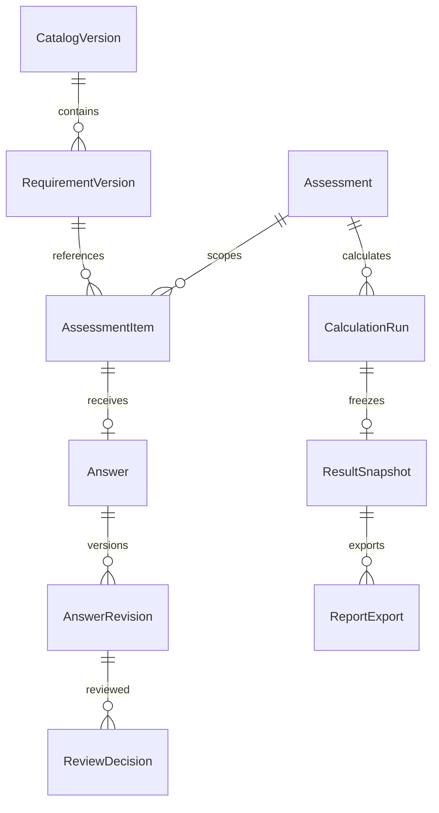

# Логическая модель — проект

OrganizationProfile: единственный профиль; ProtectionContour: принадлежит профилю. Assessment: даты, автор, состояние, версия каталога, предыдущее обследование при повторной оценке. AssessmentScope фиксирует выбранные контуры, уровни и область, чтобы последующее изменение профиля не меняло историю.

CatalogVersion → RequirementVersion (1:N). Версия требования содержит код, раздел, процесс/подпроцесс, направление/этап при необходимости, применимость, редакцию, страницу/пункт, статус ручной проверки. Иерархию можно хранить узлами каталога, не создавая отдельную таблицу для каждого вида узла.

Assessment → AssessmentItem (1:N) → RequirementVersion (N:1). AssessmentItem фиксирует контекст оценки: область/уровень, процесс для мер управления, применимость. Одна мера управления может оцениваться отдельно для нескольких процессов; уникальности только по коду меры недостаточно.

AssessmentItem → Answer (1:1); Answer → AnswerRevision (1:N). Значение оценки допускает отсутствие, отдельно от статуса. ReviewDecision ссылается на конкретную ревизию, автора и время; новая ревизия требует нового решения. Связь Evidence с ревизиями — учебный фрагмент студента, окончательная кардинальность пока не выбрана. Каждый файл обязан иметь однозначное обследование и контекст версии требования; перекрёстное присоединение из другого обследования запрещено.

ScopeExclusion хранит основание, область и решение проверяющего. CompensatingMeasure связана с заменяемой мерой и её обоснованием, не даёт автоматическую единицу. Finding принадлежит обследованию; хранит источник обнаружения, обстоятельства, расследование, меры реагирования и мотивированное решение об учёте в Z.

CalculationRun относится к обследованию и фиксирует входы, версии алгоритма/каталога и протокол. ResultSnapshot сохраняет утверждённый расчёт, область, реквизиты организации и подтверждённые ответы. ReportExport ссылается на снимок. AuditEvent фиксирует субъекта, действие, объект и время.

До миграций уточнить: кардинальность файлов, запрет собственного утверждения, блокировки состояний и ограничения уникальности контекста оценки. Модель не реализована в ORM.
